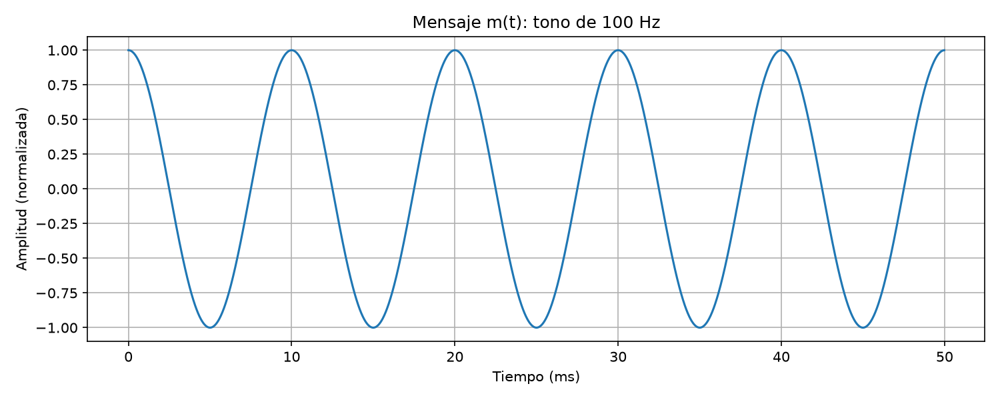
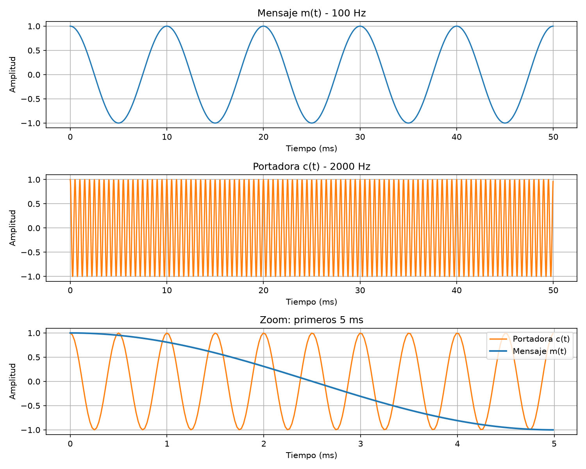
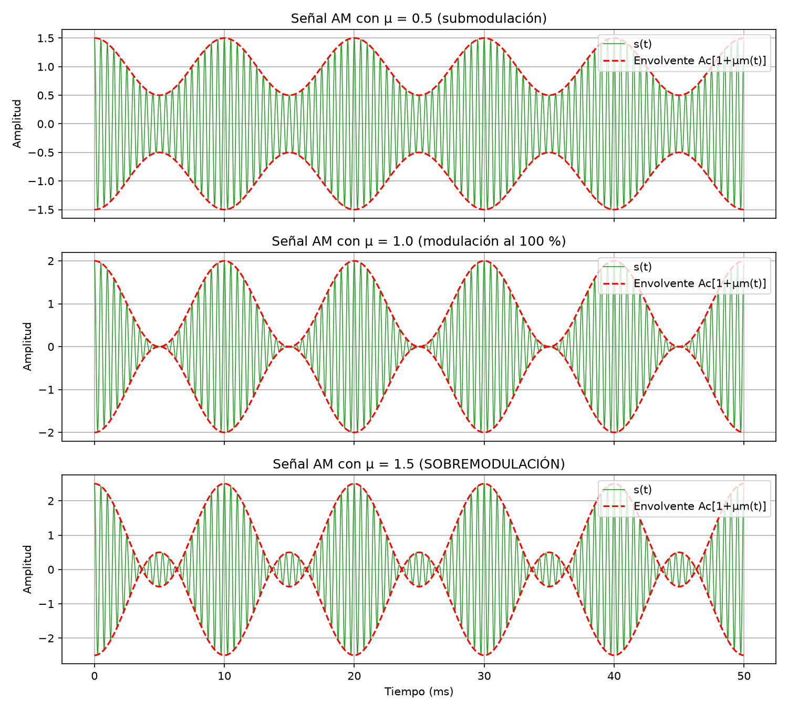
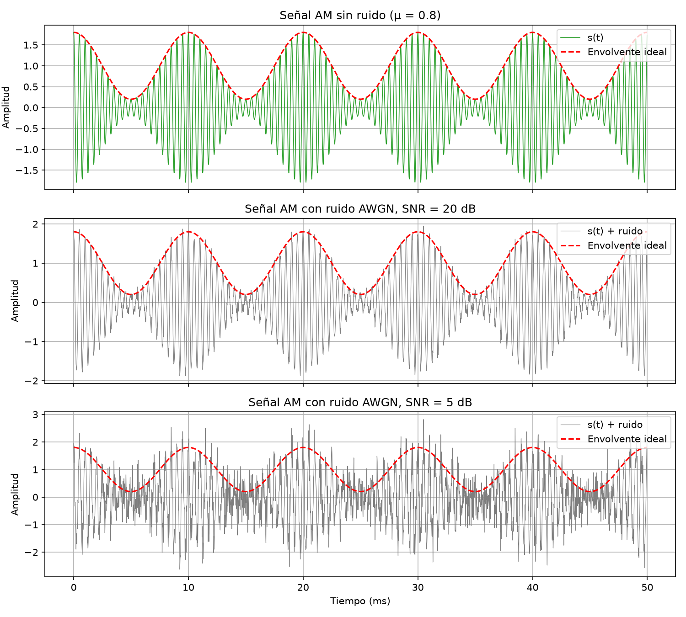
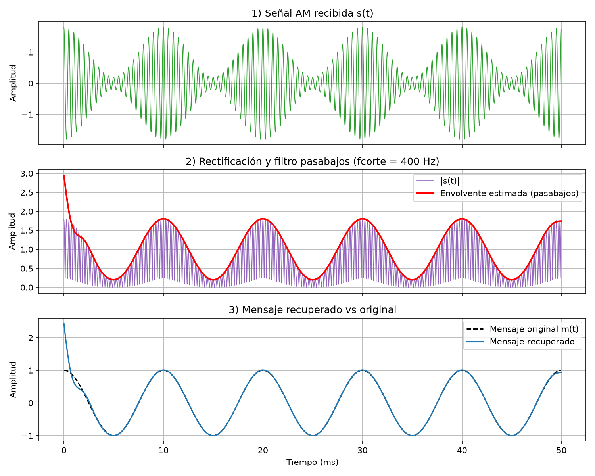
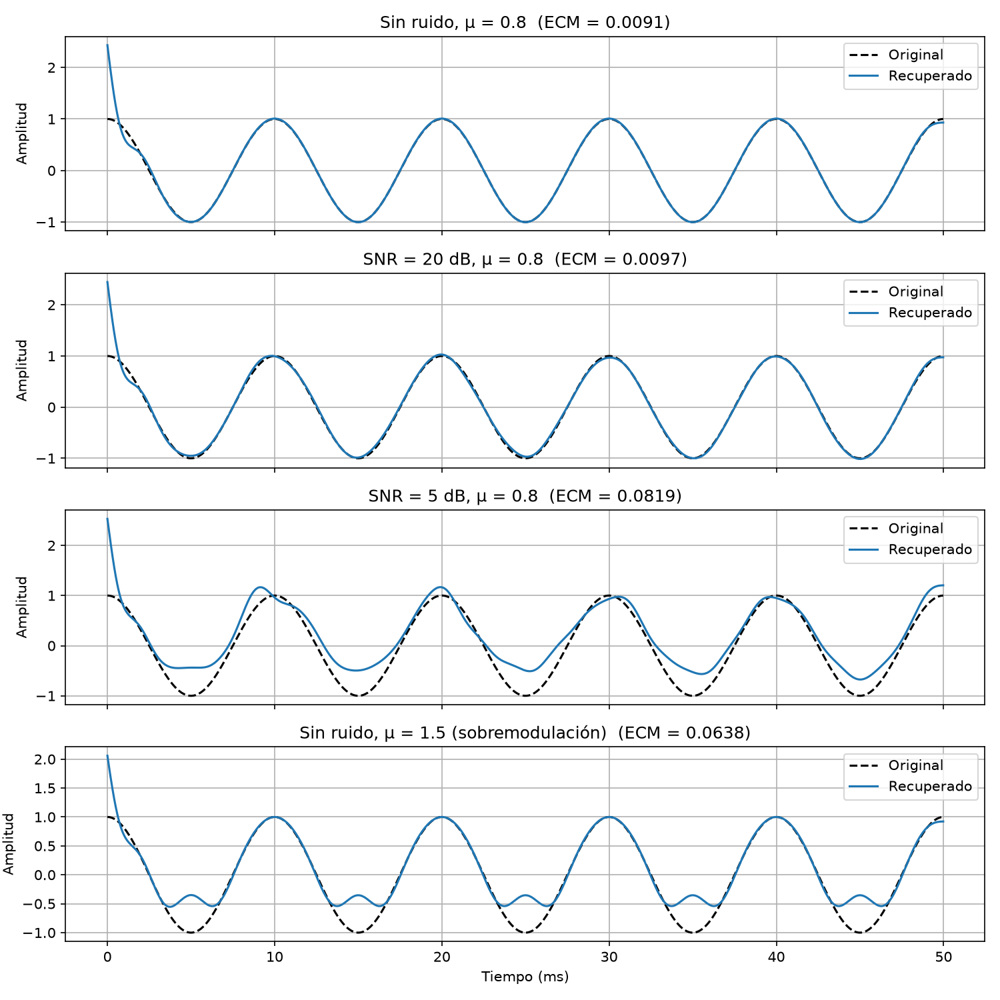
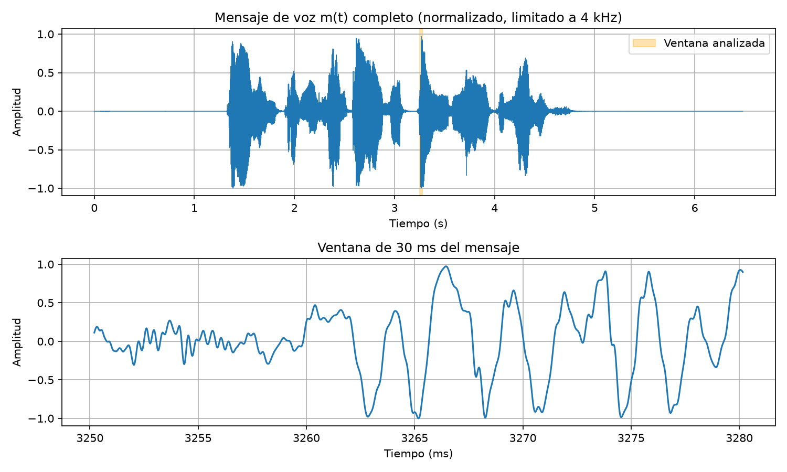
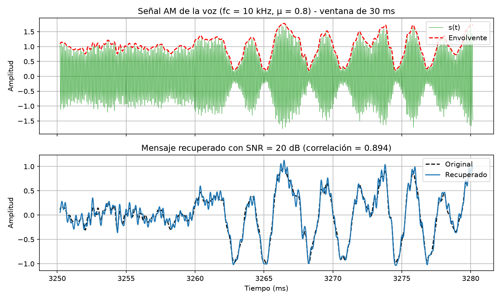
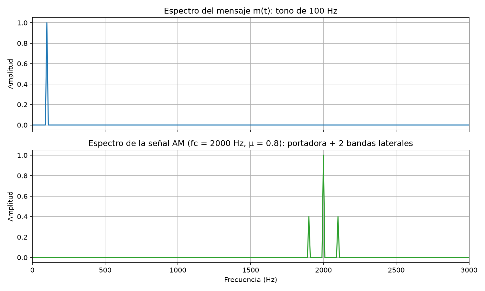
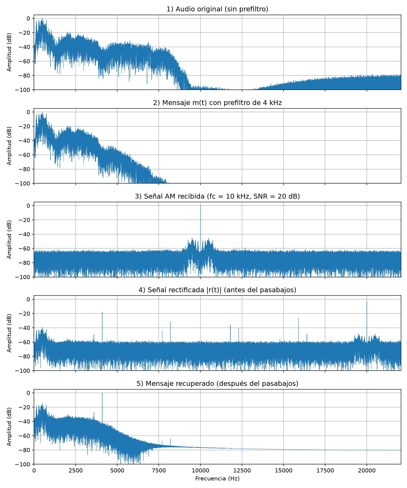

# Transmisor y receptor AM de audio

Proyecto de Teoría de Señales – Universidad de Manizales
Hecho por: Juan Sebastián Gallego
Entrega 2 (implementación inicial)

## ¿De qué se trata?

La idea del proyecto es simular en Python cómo funciona una transmisión por AM, como la de las emisoras de radio. Tomo una señal de audio (mi voz), la "monto" sobre una portadora de alta frecuencia, le agrego ruido como si pasara por el aire, y después intento recuperar el mensaje original en el receptor.

Más que hacer que funcione, lo que quiero es entender qué le pasa a la señal en cada paso, tanto en el tiempo como en frecuencia, y ver qué tanto afectan el índice de modulación y el ruido.

## ¿Cómo va?

Lo que ya funciona:
- Primero hice todo con un tono de 100 Hz porque es más fácil de ver y comprobar, y luego lo pasé a mi voz grabada.
- La portadora y la modulación AM, probando tres índices de modulación (0,5, 1 y 1,5).
- Le agrego ruido blanco con la SNR que yo quiera.
- El receptor con detector de envolvente (rectificar y filtrar).
- Mido qué tan bien se recupera el mensaje con el error cuadrático medio y la correlación.
- Saqué el espectro con FFT de cada etapa.

Lo que me falta:
- Diseñar bien los filtros cuando los veamos en clase. Por ahora usé un Butterworth de SciPy y elegí la frecuencia de corte con lógica, pero no lo diseñé yo.
- Hacer un receptor coherente (síncrono) y compararlo con el de envolvente.
- Probar muchas SNR y hacer una gráfica de qué tan bien se recupera la voz según el ruido.
- Si alcanza el tiempo, comparar con DSB-SC o SSB, que aprovechan mejor la potencia.

## Datos que usé

- El tono de prueba lo genero en el código (`src/senales.py`).
- La voz es una grabación mía hecha con Audacity, está en `data/voz.wav`. Es mono, a 44 100 Hz y 16 bits, y dura 6,48 segundos.
- El ruido también lo genero en el código. Le puse una semilla fija (42) para que siempre salga el mismo ruido y los resultados se puedan repetir.

## Cómo correrlo

Necesitas Python 3.10 o más reciente.

```bash
git clone https://github.com/sebas-2004/transmisor-receptor-am.git
cd transmisor-receptor-am
python -m venv venv
venv\Scripts\activate          # en Windows (en Linux/Mac: source venv/bin/activate)
pip install -r requirements.txt
```

Hay tres scripts, y se corren desde la carpeta principal del proyecto:

- `python src/main.py` → todo con el tono: mensaje, portadora, los tres índices, ruido y receptor.
- `python src/audio_am.py` → lo mismo pero con mi voz. Guarda los audios en `results/` para escucharlos.
- `python src/espectro.py` → la parte de frecuencia con FFT.

Las gráficas se guardan en `results/`. Ojo: al correr cada script se abren ventanas con las gráficas y hay que cerrarlas para que termine.

Usé NumPy para los cálculos, SciPy para el filtro y para leer/guardar los .wav, y Matplotlib para graficar. Todas las funciones del sistema están en `src/senales.py` y los otros scripts las van llamando.

## Conceptos de la materia que usé

- **Muestreo:** trabajé con fs = 44 100 Hz, o sea Ts ≈ 22,68 µs entre muestras. Revisé que se cumpliera Nyquist: la señal AM llega hasta fc + B, y eso tiene que quedar por debajo de fs/2 = 22 050 Hz. Con el tono llega a 2 100 Hz y con la voz a 14 000 Hz, así que estoy bien.
- **Señales periódicas:** el tono (T = 10 ms) y la portadora (T = 0,5 ms con fc = 2 kHz).
- **Modulación AM:** s(t) = Ac·[1 + μ·m(t)]·cos(2π·fc·t). El mensaje queda en la envolvente, que es Ac·[1 + μ·m(t)]. Para que esto funcione, m(t) tiene que estar entre −1 y 1, por eso normalizo.
- **Índice de modulación y sobremodulación.**
- **Potencia promedio** P = (1/N)·Σ x[n]² y la **eficiencia** de la AM, que es la parte de la potencia que de verdad lleva el mensaje.
- **Ruido blanco gaussiano (AWGN)** y **SNR** en dB: SNR = 10·log₁₀(Ps/Pn).
- **Rectificación y filtro pasabajos** en el receptor.
- Procesamiento del audio: **quitar el nivel DC, normalizar, pasar a mono y escoger una ventana** para analizar.
- **FFT:** calcula X[k] = Σ x[n]·e^(−j2πkn/N). Cada punto corresponde a la frecuencia f = k·fs/N, y la separación entre puntos (resolución) es fs/N. Grafico solo las frecuencias positivas y escalo la amplitud por 2/N para que el pico de un coseno de amplitud 1 mida 1.
- **Traslación en frecuencia** y **ancho de banda** de la AM, que es el doble del ancho del mensaje.

## Resultados

### 1. El mensaje de prueba


Es un coseno de 100 Hz durante 50 ms (2 205 muestras). Se ven 5 ciclos, que cuadra con un periodo de 10 ms. Va de −1 a 1 y la media da prácticamente 0, porque lo que sube se cancela con lo que baja.

### 2. Mensaje y portadora


La portadora es de 2 kHz, 20 veces más rápida que el mensaje. En la gráfica completa se ve casi como un bloque porque tiene 100 ciclos, por eso hice zoom a los primeros 5 ms: ahí caben 10 ciclos de portadora mientras el mensaje apenas va bajando de 1 a −1. Esa diferencia de velocidades es lo que permite modular.

### 3. Modulación con distintos índices


| μ | Envolvente mínima | Eficiencia | Qué pasa |
|---|---|---|---|
| 0,5 | 0,50 | 11,1 % | Bien, la envolvente nunca llega a cero |
| 1,0 | 0,00 | 33,3 % | Justo en el límite, toca cero |
| 1,5 | −0,50 | 52,9 % | Sobremodulación |

Con μ = 0,5 y μ = 1 la línea roja (envolvente) tiene la misma forma del mensaje. Con 1,5 las líneas rojas se cruzan, o sea que la envolvente se vuelve negativa y el contorno de la señal ya no se parece al mensaje.

Algo que me llamó la atención es la eficiencia: incluso con μ = 1, solo un 33 % de la potencia lleva el mensaje. El resto se va en la portadora.

### 4. Ruido


De aquí en adelante usé μ = 0,8. La potencia de la señal AM me dio ≈ 0,66, y la calculé a mano con P = (Ac²/2)·(1 + μ²/2) y da lo mismo, así que el código está bien.

Con 20 dB la señal se ve "peluda" pero el contorno se distingue. Con 5 dB el ruido es casi del mismo tamaño que lo que varía la envolvente y en varias partes se pierde. La SNR que mido no da exactamente 20 o 5, sino algo muy cercano, porque el ruido es aleatorio.

### 5. Receptor


Aquí se ven los pasos del receptor: la señal recibida, después de rectificarla (todo queda positivo) y el filtro pasabajos que "suaviza" y deja solo la forma del mensaje. Multiplico por π/2 porque el promedio de |cos| es 2/π.



| Caso | ECM | Correlación |
|---|---|---|
| Sin ruido, μ = 0,8 | 0,00907 | 0,9915 |
| 20 dB | 0,00971 | 0,9908 |
| 5 dB | 0,08191 | 0,9711 |
| Sin ruido, μ = 1,5 | 0,06384 | 0,9594 |

Sin ruido sale casi igual al original (solo hay una diferencia al principio y al final por el filtro). Con 5 dB sale con ondas y un poco corrido hacia arriba, porque al rectificar el ruido también se vuelve positivo y suma. Lo más interesante es μ = 1,5: aunque no tiene ruido, sale mal, porque en los valles el mensaje "rebota" en vez de bajar. Con esto comprobé que la sobremodulación sí daña el mensaje.

### 6. Con mi voz


La grabación dura 6,48 s (285 768 muestras). La media da 0 porque le quité el DC, y el RMS da 0,152, que es bajito. Tiene sentido porque la voz pasa casi todo el tiempo en volumen bajo o en silencio, con algunos picos. Un tono tiene RMS de 0,707.

A diferencia del tono, la voz no es periódica: se ven bloques que son las sílabas y silencios entre ellas. Pero en el zoom de 30 ms sí se ve un patrón que se repite, que viene de la vibración de las cuerdas vocales.

Para la voz usé una portadora de 10 kHz y antes de modular le pasé un filtro de 4 kHz, para que el mensaje tuviera un ancho de banda definido (la voz se entiende bien hasta ahí, como en el teléfono).



Con 20 dB de SNR la correlación me dio 0,894 (ECM = 0,0058), más baja que con el tono. Al principio no entendía por qué, pero es por la eficiencia: como la voz tiene RMS tan bajo, solo cerca del 1,5 % de la potencia es mensaje. Entonces aunque la SNR total sea 20 dB, el mensaje en sí queda mucho más tapado por el ruido. Para comprobarlo probé con más SNR:

| SNR (dB) | Correlación |
|---|---|
| 20 | 0,894 |
| 30 | [0.9372] |
| 40 | [0.9420] |

En `results/` dejé los audios para escuchar: la voz original filtrada, cómo "suena" la señal AM (un pitido agudo con ruido) y la voz recuperada, que se entiende bien con un poco de siseo.

### 7. Espectro (FFT)


Usé 0,1 s de señal para que la resolución fuera de 10 Hz exactos y las frecuencias cayeran justo en un punto de la FFT. El mensaje es una sola raya en 100 Hz. La señal AM tiene tres rayas: la portadora en 2 000 Hz (amplitud 1) y dos bandas laterales en 1 900 y 2 100 Hz (amplitud 0,4 = μ/2). Esto es justo lo que dice la teoría al expandir la fórmula de AM, y los valores medidos dieron iguales a los teóricos.

O sea, el mensaje se "movió" alrededor de la portadora y ocupa 200 Hz, el doble de su frecuencia. También se ve otra vez el problema de eficiencia: la raya más grande es la portadora, que no lleva información.



Esta gráfica muestra todo el sistema en frecuencia:
1. La voz original tiene casi toda su energía en frecuencias bajas.
2. Después del prefiltro ya no hay casi nada por encima de 4 kHz.
3. En la AM la voz aparece copiada a los dos lados de 10 kHz (de 6 a 14 kHz) con un pico grande de portadora. El ruido se ve como un piso plano en todo el espectro, que es por lo que se llama ruido "blanco".
4. Al rectificar, la voz vuelve a 0–4 kHz, pero aparecen cosas cerca de 20 kHz y un pico en 0 Hz. Por eso hace falta el pasabajos.
5. Después del filtro solo queda la parte de 0 a 4 kHz. El ruido que cae en esa misma banda no se puede quitar, y por eso la correlación nunca llega a 1.

## Referencias

1. S. Haykin y M. Moher, *Communication Systems*, 5.ª ed. Wiley, 2009.
2. B. P. Lathi y Z. Ding, *Modern Digital and Analog Communication Systems*. Oxford University Press.
3. A. V. Oppenheim y A. S. Willsky, *Signals and Systems*, 2.ª ed. Prentice Hall, 1997.
4. Documentación de NumPy sobre la FFT: https://numpy.org/doc/stable/reference/routines.fft.html
5. Documentación de SciPy sobre el filtro Butterworth: https://docs.scipy.org/doc/scipy/reference/generated/scipy.signal.butter.html